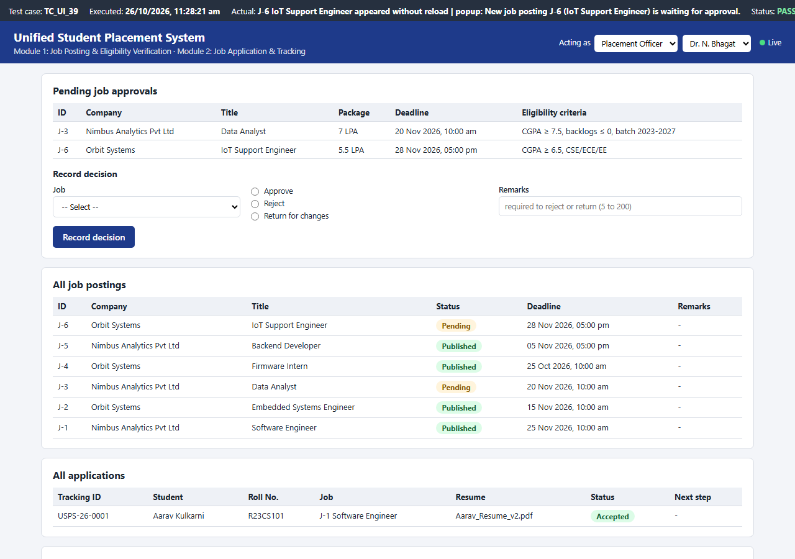

# Unified Student Placement System (USPS)

A campus placement portal for students, recruiters and the placement cell, built as my Software Engineering
Lab PBL (24CS01PR0502, RCoEM / Ramdeobaba University, Nagpur). It implements two modules of the USPS SRS:

- **Module 1 - Job Posting and Eligibility Verification:** recruiters of approved companies post jobs with
  package, deadline and eligibility criteria; the placement officer approves, rejects or returns them; returned
  postings can be edited and resubmitted; students search published jobs, and every student is checked against
  each job automatically, with the reason for every unmet criterion.
- **Module 2 - Job Application and Tracking:** eligible students apply with an active resume before the
  deadline and get a tracking id; the recruiter moves each application through the stages of the application
  statechart (review, shortlist, interview, selection, offer); students withdraw, accept or decline offers and
  follow a timeline with notifications.

Every open page updates itself within 2 seconds when someone else changes data - a job posted by a recruiter
appears in the officer's pending list, an approved job appears on the eligible students' job boards.



## Run it

Python 3.11 or later, standard library only - nothing to install.

```
python run.py
```

Open http://127.0.0.1:8091 and choose who you are acting as (Student, Recruiter or Placement Officer) in the
top bar. Login is outside the two modules, so the page lets you pick the user. The database
(`data/usps.db`) is created with demo data on the first start; delete it to start again.

Demo data: students Aarav (CSE, CGPA 8.60), Diya (IT, 7.40), Kabir (ECE, 6.80, 1 backlog), Meera (already
placed) and Rohan (ME, 2 backlogs); recruiters Ritika (Nimbus Analytics), Sameer (Orbit Systems) and Anil
(Vertex Labs, company not approved); placement officer Dr. N. Bhagat; jobs J-1 to J-4 (J-3 pending, J-4 past
its deadline).

## Project structure

| Path | Contents |
|------|----------|
| `app/rules.py` | Business rules of both modules: posting validation, `EligibilityCriteria`, officer decisions, the application statechart, tracking ids |
| `app/server.py` | REST API, actor checks (only officers approve postings, recruiters see only their own applicants), live-update version |
| `app/db.py` | SQLite schema and demo data |
| `app/static/` | The page: student, recruiter and officer views |
| `tests/` | 155 automated test cases: unit, API, integration and UI tests in headless Microsoft Edge |
| `docs/requirements.md` | Functional requirements FR-1.1 to FR-2.12 with every message |
| `docs/bugs.json` | The four bugs found by testing, with fix and retest |
| `docs/*.pdf, *.pptx` | Project report and presentation |
| `jira/` | Product backlog (epics, stories, tasks, sub-tasks, bugs) and the Jira issue keys |
| `results/`, `evidence/` | Test runs 1-4 and screenshots |

## Tests

```
python -m tests.run_tests run4        # all 155 cases; writes results/run4.json
python -m unittest -v tests.test_all  # the Python cases through unittest
```

The UI cases need Microsoft Edge. Test techniques: functional, unit, integration, boundary value analysis,
equivalence partitioning and validation testing. Run 1 found a bug in the apply form and exploratory testing
found three more (two race conditions and approval after the deadline); all four were fixed and the final run
passes 155 of 155.

## API

| Method and path | Purpose |
|-----------------|---------|
| `POST /api/jobs`, `PUT /api/jobs/<id>` | Post a job / resubmit a returned job |
| `POST /api/jobs/<id>/decision` | Approve, reject or return a posting |
| `GET /api/jobs?q=&location=&min_ctc=&eligible_only=&page=&student_id=` | Job board with eligibility |
| `GET /api/jobs/<id>/eligibility?student_id=` | Eligibility check with reasons |
| `POST /api/applications` | Apply |
| `POST /api/applications/<id>/events`, `/withdraw` | Next stage, offer response, withdrawal |
| `GET /api/applications`, `/api/applications/<id>` | Applications and their timeline |
| `GET /api/notifications`, `/api/version` | Notifications; data version polled by the pages |
